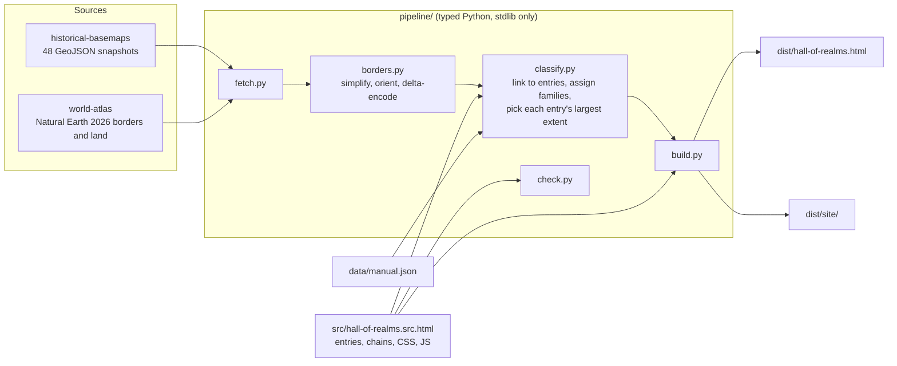

# Hall of Realms

An interactive atlas of 695 states, empires and peoples from 3100 BCE to 2026. Each region of the world is a hall, each row in a hall follows one line of succession, and each bar is colored by the language family of the group that ruled. Choosing a year redraws that year's borders on a flat map or a globe and lists everything standing then. Selecting anything opens an encyclopedia entry with its dates, rulers' language, predecessors, successors, contemporaries and a locator map of its greatest mapped extent.

The page ships in three looks: Retro (the default, a 1990s CD-ROM encyclopedia), Light and Dark.

## Why it exists

Printed world-history charts show who ruled where, decade by decade, but they stop at one size and one moment of publication. This version zooms from five millennia down to single years, ties every bar to the map, follows successions explicitly instead of by row position, and runs to the present day.

## Usage

The built page is one static HTML file with no server. Open `dist/hall-of-realms.html` in a browser, or host `dist/site/` on any static host.

Links can open the page in a given state with hash parameters:

| Parameter | Effect |
|---|---|
| `y=1250` | pin the year (negative for BCE) |
| `sel=Roman%20Empire` | open the entry with that exact name |
| `q=khanate` | filter the timeline by a search term |
| `view=globe` | start on the globe |
| `big=1` | start with the map enlarged |
| `skin=light` | `retro`, `light` or `dark` |

### Building

Requires Python 3.10 or later and no third-party packages. `mypy` is needed only for `make typecheck`.

```bash
make fetch      # download the border sources into .cache/sources (about 60 MB, pinned versions)
make check      # validate the entry table and succession chains
make page       # build dist/hall-of-realms.html (single file, map data inline)
make site       # build dist/site/ (index.html, app.js, mapdata.js; data loads after the page text)
make typecheck  # mypy --strict over the pipeline
```

`make page` runs every step it needs, including the download, the border simplification and the classification.

### Editing the content

Everything a reader sees lives in `src/hall-of-realms.src.html`:

- `RAW` holds one entry per line: `name|start|end|family|regions|c|note`. `c` marks a people or culture rather than a state; `regions` is a space-separated list of hall codes; `note` is optional.
- `CHAINS` holds successions, one chain per line: `A > B > C` means B followed A and C followed B.
- `FAMS` and `REGIONS` define the language families and halls.

`data/manual.json` maps border-file territory names to entries (`alias`) or straight to a family (`family`) when the automatic matching gets one wrong. `build/unclassified.json` lists territories still grey after a build, largest first.

Corrections are welcome; see [CONTRIBUTING.md](CONTRIBUTING.md).

## Known limits

- Dates are conventional ranges from standard reference chronologies. Early dates are approximate, and many polities began and ended gradually.
- Color shows the ruling group's language, which often differs from the language of the people they ruled.
- The border data has 48 historical snapshots plus present-day borders. The map shows the latest snapshot at or before the chosen year, so between snapshots it lags events.
- Territories are matched to entries and families by name, alias tables and keyword rules. About 1.2% of border detail stays grey as unclassified, and some matches will be wrong.

## License

GPL-3.0; see [LICENSE](LICENSE). The historical border data is derived from a GPL-3.0 work, and the project carries the same license as a whole. Third-party sources and their terms are in [NOTICE.md](NOTICE.md).

## How it works

The page is a single HTML document. Canvas draws the timeline and axis; d3 draws the map, the globe and the locator maps. A Python pipeline turns the public border datasets into a compact, classified data block that the build step embeds in the page or writes beside it.



Steps in order:

1. `fetch.py` downloads the snapshots at a pinned commit and the world-atlas files at a pinned version, retrying truncated downloads and skipping files already cached.
2. `borders.py` simplifies each ring with Douglas-Peucker at 0.07 degrees, winds exteriors clockwise for d3, drops slivers, and stores coordinates as delta-encoded integers in hundredths of a degree.
3. `classify.py` reads the entries straight from the page source, so the map and the timeline cannot drift apart. Each territory tries, in order: an alias, an entry alive within 60 years of the snapshot (exact name, then core words), the polity it belongs to, the manual family table, a colonial suffix such as "(UK)", keyword rules, and a continent fallback. It also records, for each entry, the snapshot where it covers the most area, which becomes the locator map in the article.
4. `build.py` writes the single-file page, or with `--split` a static folder whose scripts load deferred.

In the browser, the timeline uses a deep-time scale (`-(2100 - year)^0.55`) that gives recent centuries more room, packs each hall's rows by best fit, and repaints on a canvas sized to the device's pixel ratio. A polygon whose area comes out larger than a hemisphere is reversed at load, which guards against winding mistakes in the source data.
