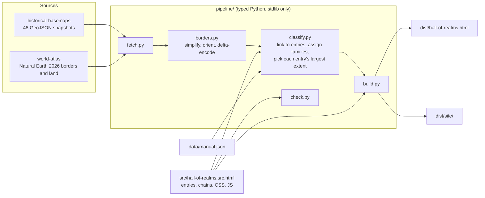

# Hall of Realms

An interactive atlas of 695 states, empires and peoples from 3100 BCE to 2026, live at [brianmwilcox.com/hall-of-realms](https://www.brianmwilcox.com/hall-of-realms/).

The world splits into twelve regional halls, and every row in a hall follows one line of succession. A bar's color shows the language family of the group that ruled. Picking a year redraws that year's borders on a flat map or a globe and lists everything standing then. Every entry opens an article with its dates, its rulers' language, its predecessors, successors and contemporaries, and a locator map of its largest mapped extent.

The timeline zooms from five millennia down to single years. A list of 382 succession links in the source decides who followed whom, so a chosen entry draws lines to its predecessors and successors wherever their bars sit. On a phone the page splits into four tabs (Timeline, Map, Index and About), articles open in a sheet that a downward swipe closes, and the timeline and map pan and zoom by touch. Light (the default) and Dark match brianmwilcox.com and follow its theme setting; a third look, Retro, is styled after a 1990s CD-ROM encyclopedia.

## Usage

The built page is static HTML with no server. `dist/hall-of-realms.html` opens straight from disk, and `dist/site/` runs on any static host.

The address keeps the whole view current (open entry, pinned year, era or visible years, language filter, search, scale, map style, phone tab and theme), so a copied link reopens what its sender saw. Each article also has a Copy link button, which becomes Share on a phone. Pasting a different link into an open tab switches the page to that view. The parameters:

| Parameter | Effect |
|---|---|
| `sel=Roman%20Empire` | opens that entry; capitals don't matter, underscores stand for spaces, and a partial name such as `sel=khiva` opens the best search match |
| `y=1250` | pins the year (negative for BCE) |
| `era=classical` | shows an era: `all`, `bronze-age`, `classical`, `medieval`, `early-modern` or `modern` |
| `t=-500,1500` | shows those years on the timeline (negative for BCE); ignored when `era` is set |
| `fam=turkic,dravidian` | shows only those language families: `indo-european`, `afro-asiatic`, `turkic`, `niger-congo`, `austronesian`, `indigenous-american`, `dravidian`, `sino-tibetan` or `other` |
| `q=khanate` | filters the timeline by a search term |
| `scale=even` | gives every century the same width |
| `view=globe` | starts on the globe |
| `big=1` | starts with the map enlarged |
| `tab=map` | on a phone, opens the `map`, `index` or `about` tab |
| `skin=retro` | shows `light`, `dark` or `retro` without changing the visitor's saved choice |

### Building

The pipeline needs Python 3.10 or later and no third-party packages; `make typecheck` also needs mypy.

```bash
make fetch      # downloads the border sources into .cache/sources (about 60 MB, pinned versions)
make check      # validates the entry table and succession chains
make page       # builds dist/hall-of-realms.html (one file, map data inline)
make site       # builds dist/site/ (index.html, app.js, mapdata.js; the data loads after the text)
make typecheck  # runs mypy --strict over the pipeline
```

`make page` runs every earlier step it depends on, the download included.

### Content

Everything a reader sees lives in `src/hall-of-realms.src.html`:

- `RAW` holds one entry per line as `name|start|end|family|regions|c|note`. A `c` marks a people or culture rather than a state, `regions` is a space-separated list of hall codes, and `note` is optional.
- `CHAINS` holds successions, one chain per line. `A > B > C` means B followed A and C followed B.
- `FAMS` and `REGIONS` define the language families and the halls.

`data/manual.json` maps territory names from the border files to entries (`alias`) or directly to a family (`family`) where the automatic matching gets one wrong. After a build, `build/unclassified.json` lists the territories still grey, largest first.

[CONTRIBUTING.md](CONTRIBUTING.md) covers corrections.

## Known limits

- Dates are conventional ranges from standard reference chronologies. Early dates are approximate, and many polities began and ended gradually.
- Color shows the ruling group's language, which often differs from the language of the people they ruled.
- The border data has 48 historical snapshots plus present-day borders. The map shows the latest snapshot at or before the chosen year, so between snapshots it lags events.
- Territories are matched to entries and families by name, alias tables and keyword rules. About 1.2% of border detail stays grey, and some matches are wrong.

## License

GPL-3.0 ([LICENSE](LICENSE)). The historical borders derive from André Ourednik's GPL-3.0 [historical-basemaps](https://github.com/aourednik/historical-basemaps), so the project carries the same license as a whole. [NOTICE.md](NOTICE.md) lists every third-party source and its terms.

## How it works

The page is one HTML document. Canvas draws the timeline and axis, and [d3](https://d3js.org/) draws the map, the globe and the locator maps. A Python pipeline turns the public border datasets into a compact, classified data block, which the build step either embeds in the page or writes beside it.



1. `fetch.py` downloads the snapshots at a pinned commit and the [world-atlas](https://github.com/topojson/world-atlas) files at a pinned version. It retries truncated downloads and skips files already cached.
2. `borders.py` simplifies each ring with Douglas-Peucker at 0.07 degrees, winds exteriors clockwise for d3, drops slivers, and stores coordinates as delta-encoded integers in hundredths of a degree.
3. `classify.py` reads the entries straight from the page source, so the map and the timeline cannot drift apart. Each territory tries an alias first, then an entry alive within 60 years of the snapshot (exact name, then core words), the polity it belongs to, the manual family table, a colonial suffix such as "(UK)", keyword rules and a continent fallback. For each entry it also records the snapshot where the entry covers the most area; that snapshot becomes the article's locator map.
4. `build.py` writes the single-file page, or with `--split` a static folder whose scripts load deferred.

In the browser the timeline uses a deep-time scale, `-(2100 - year)^0.55`, which gives recent centuries more room. Rows in each hall are packed by best fit, and the canvas matches the device's pixel ratio. Any polygon whose area comes out larger than a hemisphere is reversed at load, which corrects winding mistakes in the source data.
